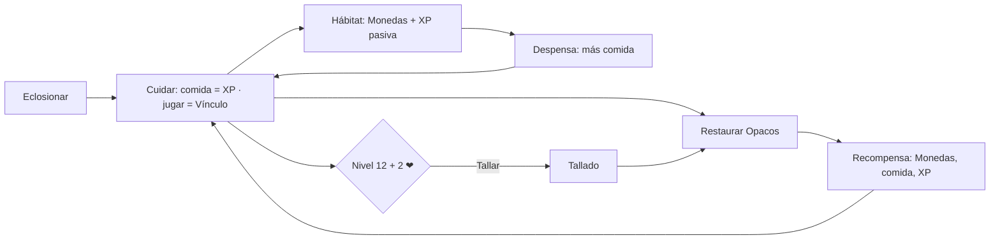

# NEXORA · Diseño de juego (Fase 1)

> Tierno al nacer. Imponente al tallarse.

## 1. Promesa
NEXORA es un juego de **colección, cuidado, evolución, santuario, aventura y combate táctico**. El
objeto emocional es la criatura: el jugador la descubre, la cuida, la hace crecer, la **talla** y la
muestra. Las referencias de género son funcionales, no modelos a copiar.

| Pilar | Qué siente el jugador | Cómo lo toca el vertical slice |
|---|---|---|
| Colección | "Quiero completar el Álbum del Nexo" | 50 especies en datos; Álbum con siluetas numeradas (vista previa) |
| Transformación | "Mi Brote se volvió imponente y sigue siendo él" | Tallado a nivel 12 con Vínculo, cambio de forma, escala ×1.5–1.6, mirada feroz |
| Santuario | "Este es mi hogar y mis monstruos viven aquí" | Lote Hogar, hábitat de 4 lugares, recolector, marca "paseando" |
| Aventura | "Devuelvo el color al valle" | Linde de las Chinampas: 3 Opacos restaurables |
| Estrategia/social | "Elijo bien mis ataques" | Elementos, Savia, especiales y Firma; acompañantes visibles para todos |

## 2. Bucle central
`Eclosionar → Cuidar → Entrenar → Explorar → Competir → Criar` (p. 108). La Fase 1 cubre
**Eclosionar → Cuidar → Entrenar (hábitat) → Explorar (Opacos)**.

## 3. Sesiones (p. 105–108)
| Sesión | Duración | Qué hace el jugador en el slice | Fase 2 añadirá |
|---|---|---|---|
| Corta | 5 min | Recoger Monedas, alimentar, jugar (Vínculo), revisar el santuario | Incubar un huevo, abrir la repisa de cofres |
| Media | 20 min | Restaurar Opacos (repetición al 25 %, tope 10/día), comprar comida, subir de nivel | Encargos diarios, arena, mezcla |
| Larga | 60 min | Llegar al Tallado, completar la región 1 | Capítulos de aventura, ascenso de división, eventos de bioma |

## 4. Primeros 15 minutos (p. 110, adaptado)
| Minuto | Momento | Paso de onboarding | Evento de analítica |
|---|---|---|---|
| 0:00 | Sueño del Tallador (5 planos, saltable) | `Intro` | `onboarding_started`, `intro_finished{skipped}` |
| 0:30 | Despertar en la plaza; tres huevos idénticos laten con su color al acercarse | `ChooseEgg` | `starter_egg_selected` |
| 2:00 | Eclosión, carta del Brote, nombre opcional; "los otros dos volverán" | `Hatch` | `hatch_completed`, `pet_follow_started` |
| 3:00 | Llegar al Lote Hogar: regalo del Gabinete (100 Monedas + 3 Raciones) | `MeetHome` | `habitat_opened`, `sanctuary_visit` |
| 3:30 | Colocar al Brote en el hábitat y primera recogida (50 Monedas) | `PlaceInHabitat` | `coins_collected` |
| 5:00 | Alimentarlo (XP, sube de nivel) | `FirstFeed` | `first_feed` |
| 5:30 | Jugar con él (Vínculo) | `FirstBond` | `first_bond_gain` |
| 7:00 | Restaurar al primer Opaco (débil ante el inicial) | `FirstBattle` | `first_battle_started`, `first_battle_completed` |
| 9:00 | Recompensa determinista (200 Monedas, 10 Gemas, 2 Raciones de bioma, XP) | `ClaimReward` | `first_reward_claimed{secondsSinceStart}` |
| 9:30 | Libre: Opaco del Canal desbloqueado, Despensa, camino al Tallado | `Done` | `tutorial_completed` |

Reglas: una sola ventana de tutorial a la vez; cada sistema se explica cuando se necesita; el
objetivo siempre visible con flecha y baliza; el paso se reconstruye desde el perfil si el jugador se
desconecta (no se repite la eclosión).

## 5. Sistemas y números (todos en `Config`)
**Monstruos.** Atributo = base del Tallado × (0,7 Brote | 1,0 Tallado) × (0,4 + 0,012·nivel); PV = VID × 10.
Iniciales a nivel 1 (Brote): Kuachi 55 PV · Xolumi 69 PV · Teselo 72 PV.

**Progresión.** XP de L a L+1 = 40·L^1,5 (nivel 12 ≈ 7 166 XP acumulada; nivel 20 ≈ 26 855). Tallado
Común a nivel 12 + 2 corazones de Vínculo. Golpe Nexo a nivel 20 en Tallado.

**Comida.** Ración básica 50 Monedas · +150 XP; Ración de bioma 220 · +600 XP · +1 Vínculo; Festín 900 · +2 500 XP · +1 Vínculo. Jugar: +1 Vínculo cada 45 s.

**Hábitat.** Común 30 Monedas/h (Brote 50 %), +10 % nativo; 2 XP/min por monstruo; tope de acumulación 8 h.

**Combate.** Turnos simultáneos resueltos por VEL; Savia: básico +1 (máx. 3), especial/Firma −2, Golpe Nexo −3 una vez. Daño = Poder × A/(A+D) × 2 × escala del atacante × elemento × afinidad (×1,2) × variación (0,95–1,05) × crítico (5 %, ×1,5). Estados: quemadura (−5 % PV/turno), parálisis, aturdimiento, sueño, confusión. Talentos de las 8 especies del slice implementados.

**Encuentros (Acto I, región 1).**
| Etapa | Opaco | Nivel | IA | Premio base | Bono de primera vez |
|---|---|---|---|---|---|
| 1 · El primer Opaco | según inicial (Agavo / Comalú / Zizi) | 1 | Tutorial | 200 Monedas · 150 XP | 10 Gemas, 2 Raciones de bioma |
| 2 · Opaco del Canal | Barrock | 4 | Normal | 350 · 250 XP | 1 Festín |
| 3 · Élite: Opaco de la Vaina | Vainas (Coraza +15 % DEF) | 7 | Normal | 600 · 400 XP | 5 Gemas, 1 Festín |
Repetición: 25 % del premio base, 10 repeticiones con premio al día. Derrota: XP de consolación, sin castigo. "Nadie muere en NEXORA": el Opaco vencido recupera su color.

## 6. Retención (preparada, sin trucos)
- **Por qué volver mañana:** el recolector acumula hasta 8 h; el Brote está a pocos niveles del Tallado; un Opaco nuevo espera en la Linde.
- **Objetivo siempre visible:** la ficha muestra el próximo hito (nivel de Tallado, corazones, Golpe Nexo).
- **Social preparado:** el acompañante y el hábitat de cada jugador son visibles para todos (estado público); visitas, regalos de comida y exhibición llegan en la Fase 3.
- **Sin energía, sin temporizadores engañosos** (p. 111 y Genesis §9).

## 7. Accesibilidad
Iconos de elemento y rareza en todos los botones; texto mínimo 14 px; botones ≥ 48 px; barras con color y número; la eficacia se indica con texto ("▲ Eficaz"); modo de alto contraste y patrones para daltonismo pendientes de la Fase 2 (p. 116).
