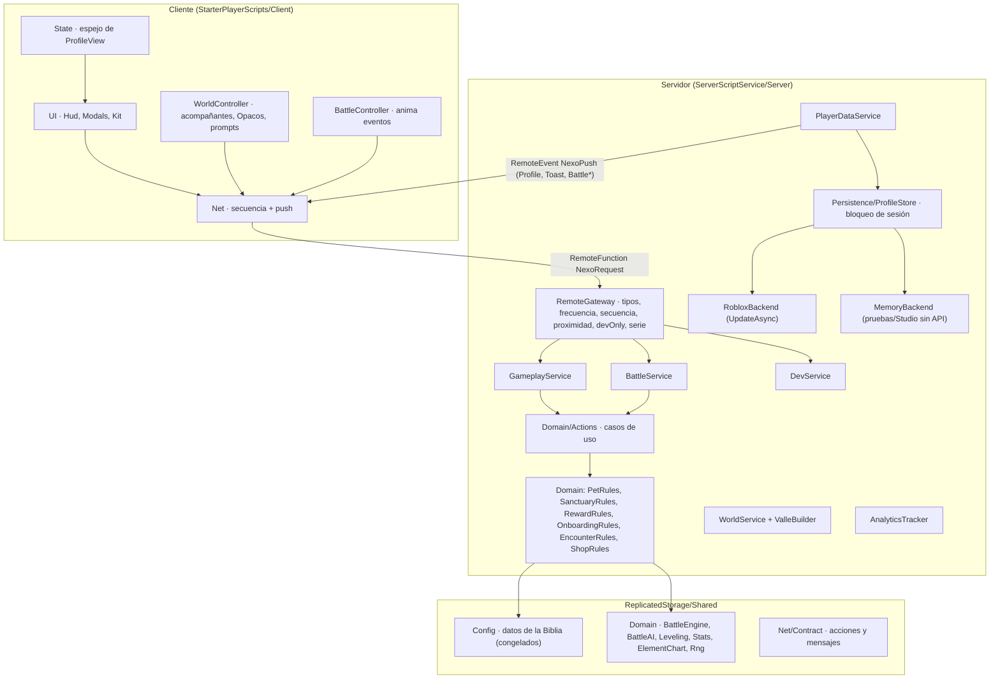
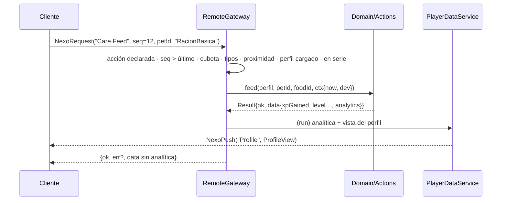

# NEXORA · Arquitectura técnica

## 1. Objetivos
- **Autoridad del servidor** en todo lo que tiene valor (economía, progreso, combate, recompensas).
- **Datos separados de la lógica:** la Biblia vive en `Shared/Config`; añadir especies, ataques, encuentros o recompensas es añadir datos.
- **Lógica probable fuera de Studio:** el dominio es Luau puro y se ejecuta con Lune en CI y en esta máquina.
- **Móvil primero y varios jugadores por servidor** (6 lotes por servidor en la Fase 1).

## 2. Capas

| Capa | Carpeta | Responsabilidad | Se prueba en |
|---|---|---|---|
| Config | `Shared/Config` | Datos de diseño congelados | Lune (`Config.spec`: presupuestos, rueda, conteos, referencias) |
| Dominio compartido | `Shared/Domain` | Combate determinista, IA, progresión, atributos | Lune + paridad con JS |
| Dominio del servidor | `Server/Domain` | Reglas sobre el perfil y casos de uso (`Actions`) | Lune (`Phase1Flow.spec`) |
| Persistencia | `Server/Persistence` | Bloqueo de sesión, migraciones, validación | Lune con `MemoryBackend` |
| Servicios | `Server/Services` | Adaptadores de Roblox | Studio (`tests/Playtest`) |
| Mundo | `Server/World` | Valle Copal procedural (blockout) | Studio |
| Cliente | `StarterPlayerScripts/Client` | Red, estado, interfaz, presentación | Studio |

## 3. Modelo de datos

**SpeciesDefinition** (`Config/Species`): id, número, Brote/Tallado, rareza, elementos, rol, familia, bioma, atributos del Tallado a nivel 50, talento, firma, mezcla mítica, procedencia, `status` (`VerticalSlice` o `Catalog`). Configuración visual aparte en `Config/Visuals` (arquetipo, paletas Brote/Tallado, escala ×1.4–1.7, rasgo firma, `assetStatus`).

**PetInstance** (perfil): `id` único `U<userId>-<serial>`, `speciesId`, `form`, `level`, `xp` (dentro del nivel), `bond`, `nickname` filtrado, `acquired {kind, ref, at}` (procedencia), `traits` (Veta/Temple/Don/Veta Dorada, neutros en Fase 1), `lineage`, `loadout` (nil = predeterminado), estadísticas.

**Perfil** (`Types.Profile`, `ProfileSchema.CURRENT_VERSION = 1`): monedas, objetos, mascotas, serial, acompañante, equipo, capacidad del Vivero, lotes y hábitats (slots, `lastCollectAt`, `accrued`, reserva), historia (superados, repeticiones diarias), onboarding, desbloqueos, recompensas (`pending`, `ledger` acotado a 500), `firsts` (analítica una vez), contadores.

Registro en DataStore: `{ meta = { lock = {jobId, at}, writes, updatedAt }, data = Profile }`.

## 4. Flujo cliente-servidor

Combate: `Battle.Start(encounterId)` (proximidad al Opaco) → el servidor crea id y semilla y envía `BattleStart`; cada `Battle.Act(battleId, turno, moveId)` valida id y número de turno, elige la acción de la IA, resuelve y envía `BattleTurn` (eventos + instantánea); al terminar, `Actions.finishEncounter` crea una recompensa pendiente `battle:<id>` y se envía `BattleEnd`. Si el jugador se desconecta, la batalla se descarta sin resultado.

## 5. Seguridad

| Amenaza | Defensa |
|---|---|
| Cliente envía cantidades o resultados | Ningún remote acepta cantidades de moneda, XP, daño o premios (prueba `Guard.spec`) |
| Tipos inválidos, NaN, cadenas enormes | `Guard.checkArgs` (tipo, longitud, UTF-8, enteros, rangos, número de argumentos) |
| Spam / automatización | Cubeta de fichas por jugador y acción (`Contract.rate`) |
| Repetición de solicitudes | Número de secuencia estrictamente creciente por jugador |
| Condiciones de carrera | Procesamiento en serie por jugador en el gateway |
| Acciones a distancia | Proximidad validada en servidor (`WorldService.isNear`) con tolerancia de 8 studs |
| Doble recompensa | `RewardRules`: id único, pendiente → reclamada una vez, registro de procedencia |
| Doble aplicación de un combate | `EncounterRules.applyResult` rechaza un `battle:<id>` conocido |
| Duplicación entre servidores | Bloqueo de sesión; guardado solo si el servidor es dueño; `LockLost` ⇒ expulsión |
| Perfil corrupto | Validación al cargar; un perfil inválido nunca se sobrescribe |
| Apodos ofensivos | `TextService` en el servidor; si falla el filtro, se rechaza |
| Comandos de prueba en vivo | `devOnly` en el contrato + `DevGate` (solo Studio, D-021) |

## 6. Persistencia
- `ProfileStore.load`: `UpdateAsync` que toma el bloqueo si está libre o caducado (30 min), migra (`Migrations[v]`), rellena campos nuevos (`reconcile`) y valida. Reintentos con espera exponencial ante fallos o bloqueo ajeno.
- `ProfileStore.save`: valida, escribe solo si el `jobId` sigue siendo dueño; `release` libera el bloqueo. Guardados concurrentes se encolan.
- `PlayerDataService`: autoguardado cada 120 s, liberación al salir con reintentos, `BindToClose` que espera a las sesiones y a los guardados en curso (hasta 25 s), bloqueo que caduca sin latido a los 360 s (60 s en Studio) y expulsión controlada si el bloqueo se perdió.
- **Almacenes:** Studio → `NEXORA_Profiles_TEST_v1` (o memoria si Studio no tiene acceso a la API); servidor publicado → `NEXORA_Profiles_v1`.
- Pruebas (`tests/Integration/Phase1Flow.spec.luau`): reconexión sin pérdida, recompensa pendiente que sobrevive a la desconexión, segundo servidor bloqueado, robo de bloqueo caducado sin sobrescritura, reintentos, perfil corrupto intacto, migraciones.

## 7. Rendimiento (móvil primero)
- `Workspace.StreamingEnabled = false` en el vertical slice (D-019); todos los prompts pasan por `ProximityPromptService.PromptTriggered`, así que reactivar el streaming no los rompe.
- Criaturas del lado del cliente, sin física ni colisiones; animación con `workspace:BulkMoveTo`; solo se animan a menos de 140 studs de la cámara.
- Solo se construyen las especies presentes (nunca las 50).
- Valle: luces puntuales ≤ 12, partículas solo en el corazón del árbol y en la niebla de los Opacos.
- Presupuestos de activos finales (Biblia p. 120): Brote 2 500–4 000 tris, Tallado común–épico 4 000–6 500, texturas 1024², huesos ≤ 18/30, emisores por rareza; prueba con 8 monstruos con aura a 30 fps en el teléfono base.
- Pendiente de medir en dispositivo real (ver `docs/ROADMAP.md`).

## 8. Pruebas y herramientas
| Comando | Qué hace |
|---|---|
| `rokit install` | Instala rojo 7.7.1, lune 0.11.1, stylua 2.6.0, selene 0.31.0 |
| `lune run tests/runner [filtro]` | Pruebas unitarias e integración (78 en este bloque) |
| `./scripts/check.sh` | Formato, lint, pruebas, `rojo build`, vista previa y paridad |
| `rojo serve` | Sincroniza con Roblox Studio (plugin de Rojo) |
| `lune run tools/web-preview/build` | Exporta la config a JSON y genera `tools/web-preview/dist/NEXORA_Preview.html` |
| `node tools/web-preview/parity.mjs` | Comprueba que 175 combates sembrados son idénticos en Luau y JS |

El arnés `tests/lib/VirtualGame.luau` reproduce el árbol de instancias de Rojo, así que los módulos usan los mismos `require(script.Parent.X)` en Studio y en Lune.

## 9. Extensibilidad prevista (sin implementar aún)
- **Equipos de 3 / Arena:** el motor ya admite 1–3 por lado; faltan el cambio de monstruo y el emparejamiento.
- **Incubadora y huevos:** `Rarities.incubationSeconds`, `PetInstance.acquired`, recompensas pendientes; la especie y los rasgos se deciden al obtener el huevo (p. 89).
- **Crianza:** `PetInstance.lineage` y `traits` existen; las 42 recetas irán a `Config/Breeding`.
- **Nuevos biomas y lotes:** `Config/Sanctuary.Lots` ya declara los 6 lotes (`implemented = false`).
- **Compras futuras:** flujo `MarketplaceService.ProcessReceipt` idempotente apoyado en `RewardRules` (id = `PurchaseId`), `PolicyService` antes de cualquier aleatoriedad pagada.
